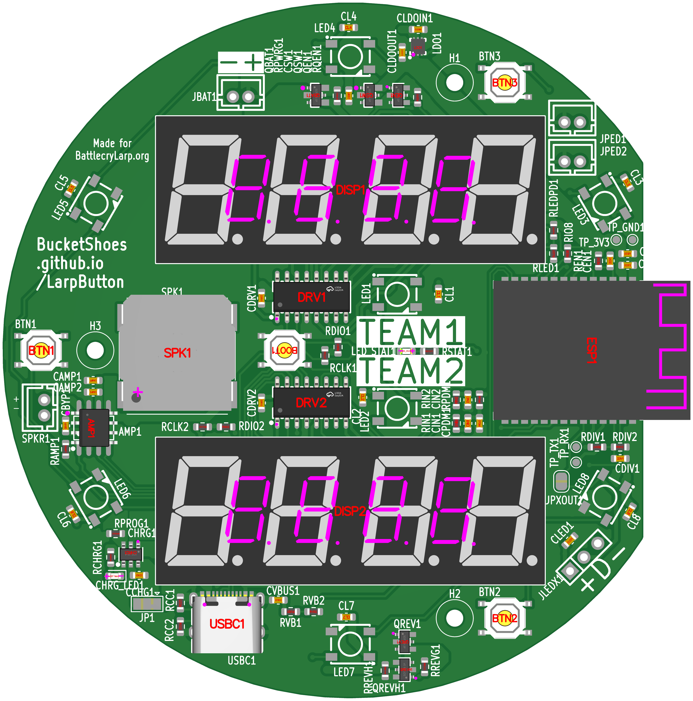
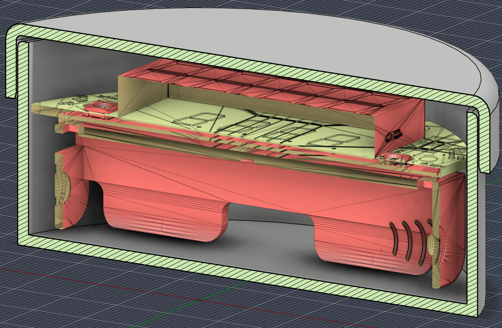

# LARP timer
Electronics project for live action roleplay, objective capture botton/timer.
Think like a chess clock, but more lights, bigger display, sound/voice callouts. Press and hold to capture an objective point, with time tracking.
ESP32 C6 based project, bluetooth admin interface for time tracking, number of swaps, team colors, and bluetooth beacons/player tracking.
PCB through JCLPCB, mostly from the basic parts list.
Built for battlecrylarp.org

# WORK IN PROGRESS
Note yet complete, untested.

